# GUI サンプル（全画面）

承認済みデザイン（`docs/design/`）どおりに実装した Qt コードを、そのままオフスクリーン描画した画像です。
メーターの値は、各ユニットの DSP エンジンに実際に音声を流して得た値です。
キー、フェーダーキャップ、ネジ、LED、つまみは Blender でレンダリングした部品画像（`resources/parts/`）を使っています。

再生成コマンド：

```bash
cmake -S . -B build -DMODEL600_BUILD_GUI_SAMPLES=ON
cmake --build build --target m600_render_gui_samples
QT_QPA_PLATFORM=offscreen QT_SCALE_FACTOR=2 ./build/m600_render_gui_samples docs/gui-samples
```

| # | 画面 | 内容 |
|---|---|---|
| 01 |  | [01] VOCAL MASTER スタジオコンソール（日本語） |
| 02 |  | 同・英語表示 |
| 03 | 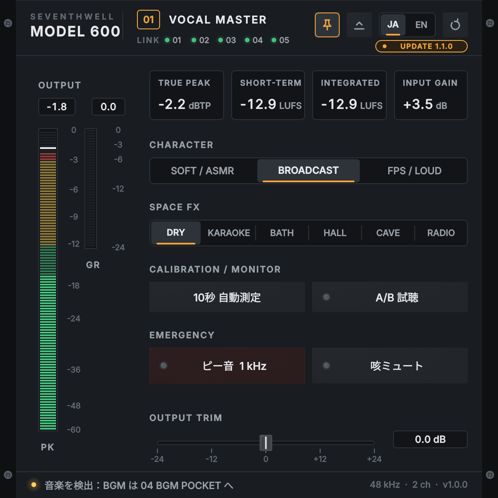 | ピン固定中、アップデートあり、BGM 挿し間違いのヒント表示 |
| 04 | 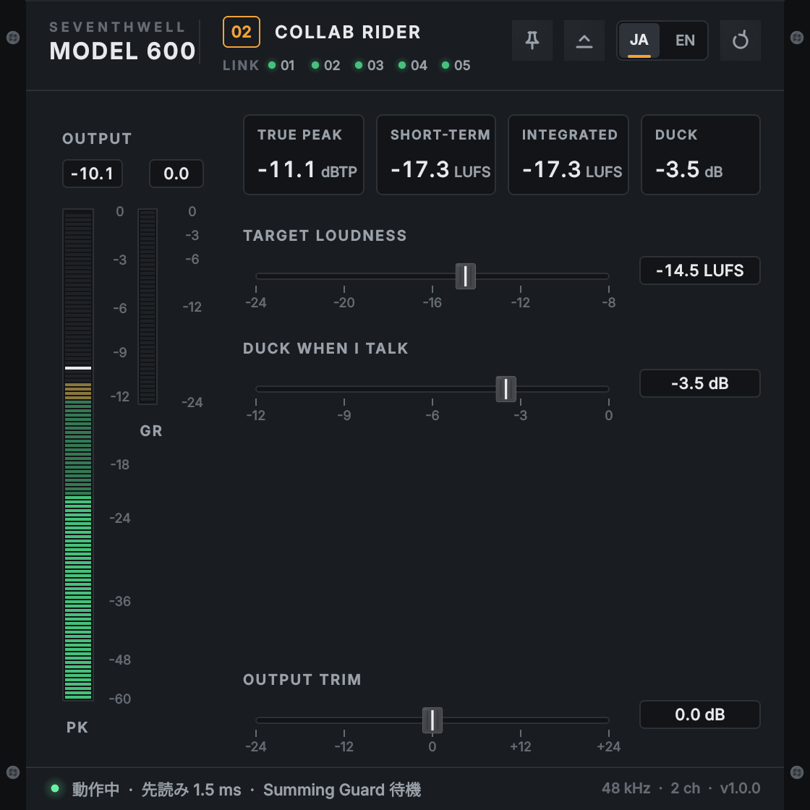 | [02] COLLAB RIDER：目標ラウドネス、話している間のダッキング量 |
| 05 | 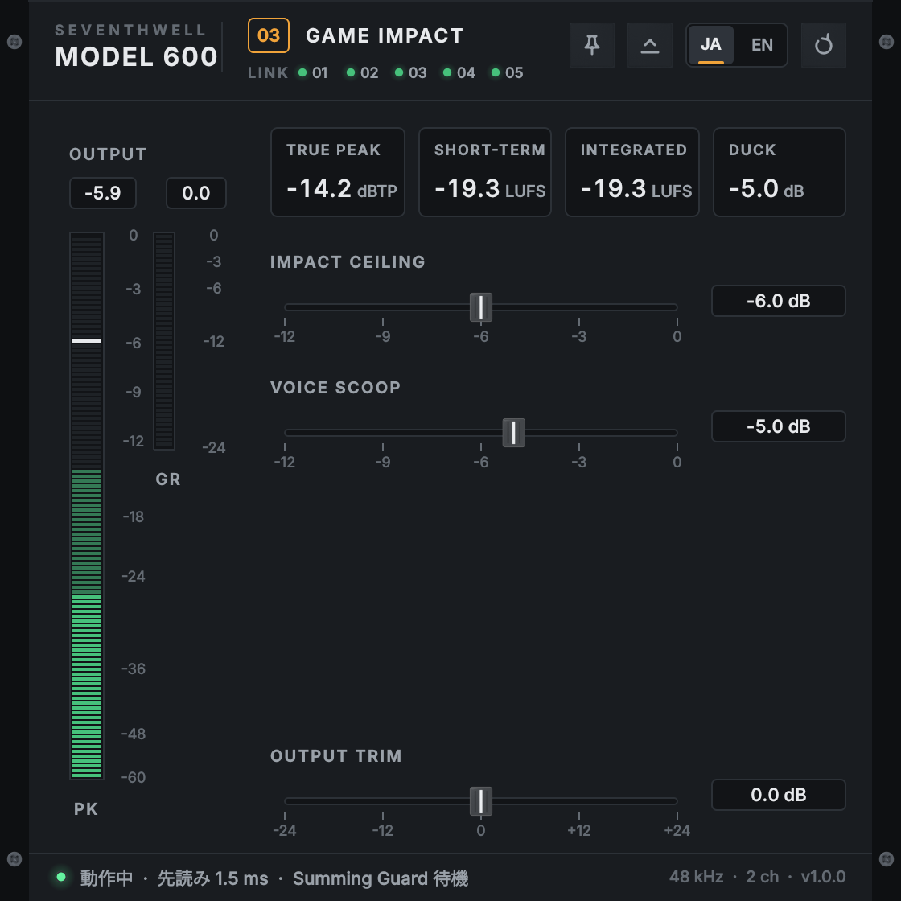 | [03] GAME IMPACT：衝撃音の天井、声の帯域スクープ |
| 06 | 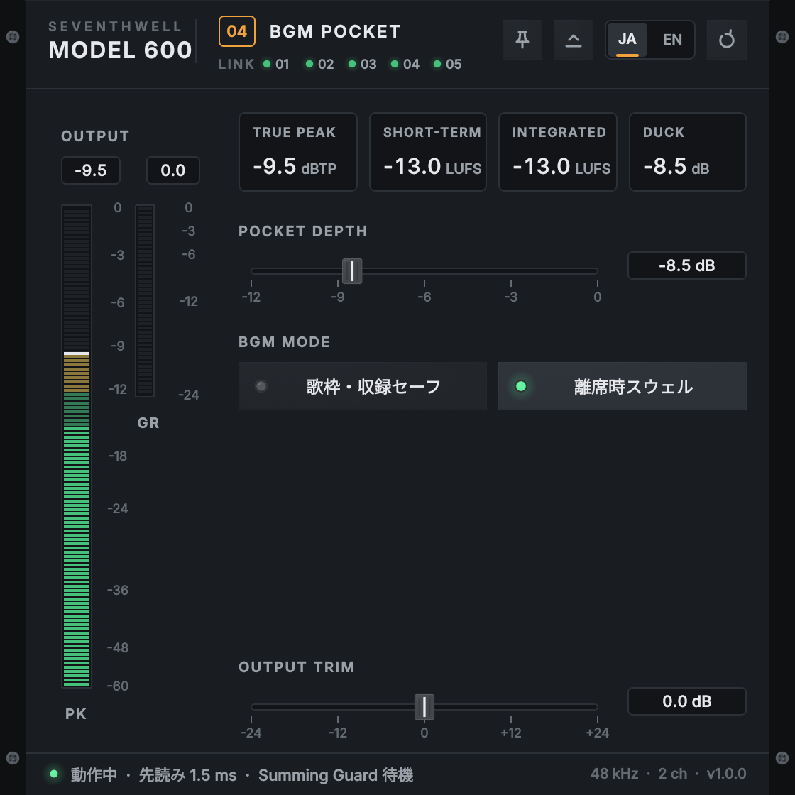 | [04] BGM POCKET：ポケット深さ、歌枠・収録セーフ、離席時スウェル |
| 07 | 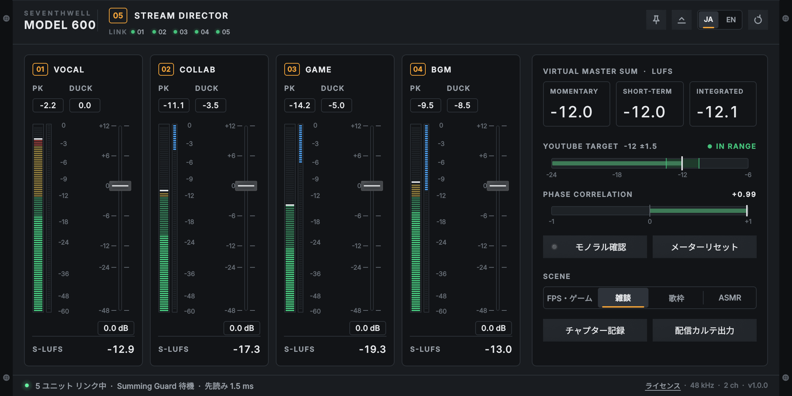 | [05] 統合ミキサー：4ch ストリップ、仮想マスター、YouTube 目標帯、位相相関、シーン切替 |
| 08 | 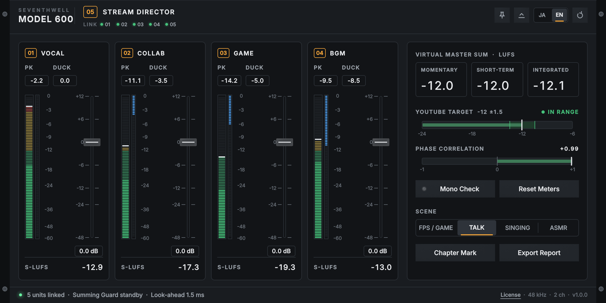 | 同・英語表示 |
| 09 | 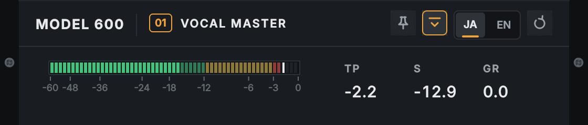 | MINI 表示（[01]、高さ120px） |
| 10 | 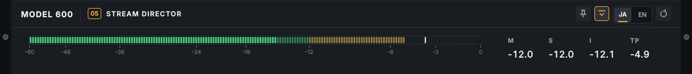 | MINI 表示（[05]） |
| 11 | 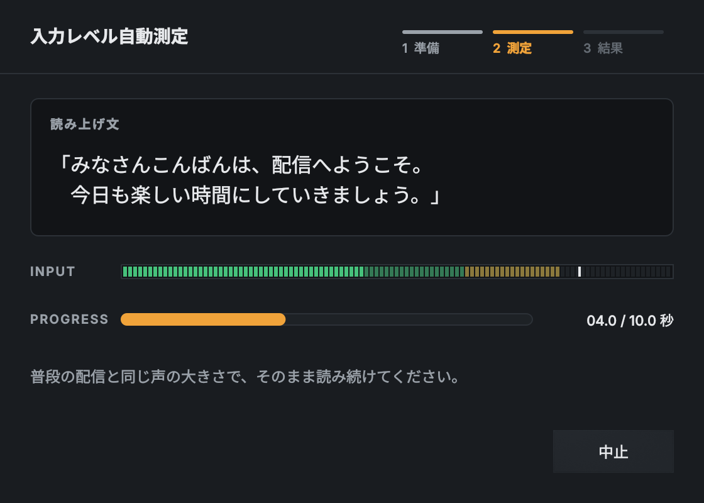 | 10秒自動測定：測定中 |
| 12 | 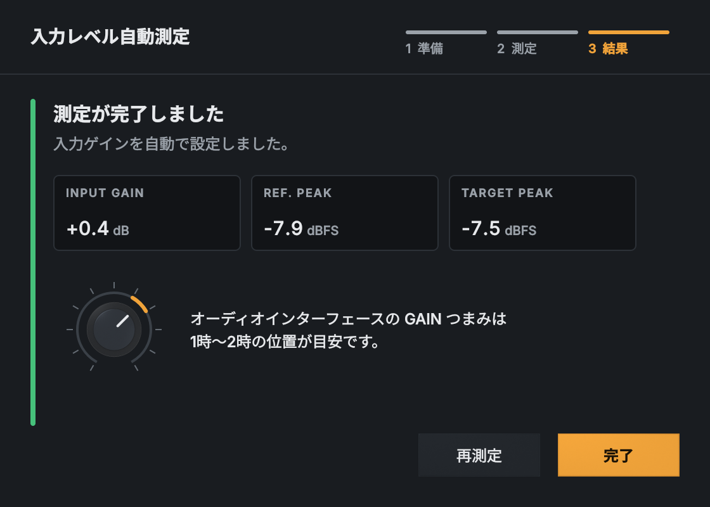 | 測定完了（GAIN つまみの目安位置を表示） |
| 13 | 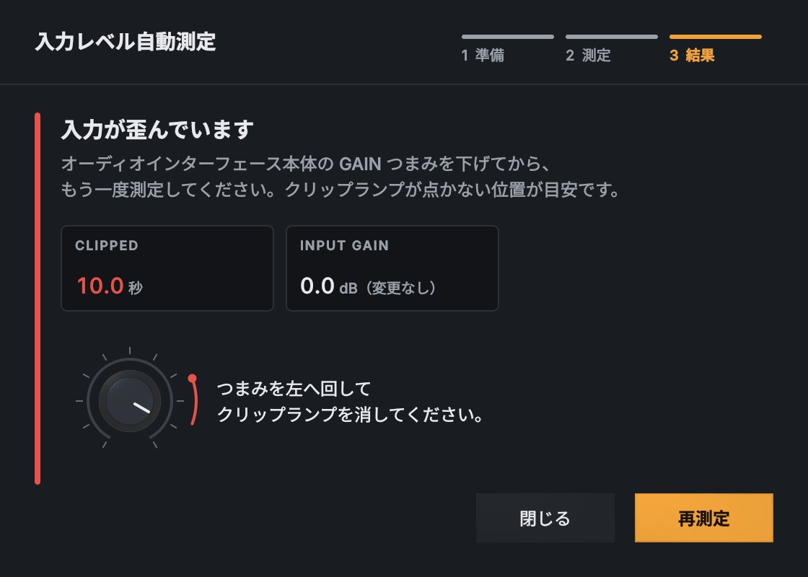 | 入力の歪みを検出 |
| 14 | 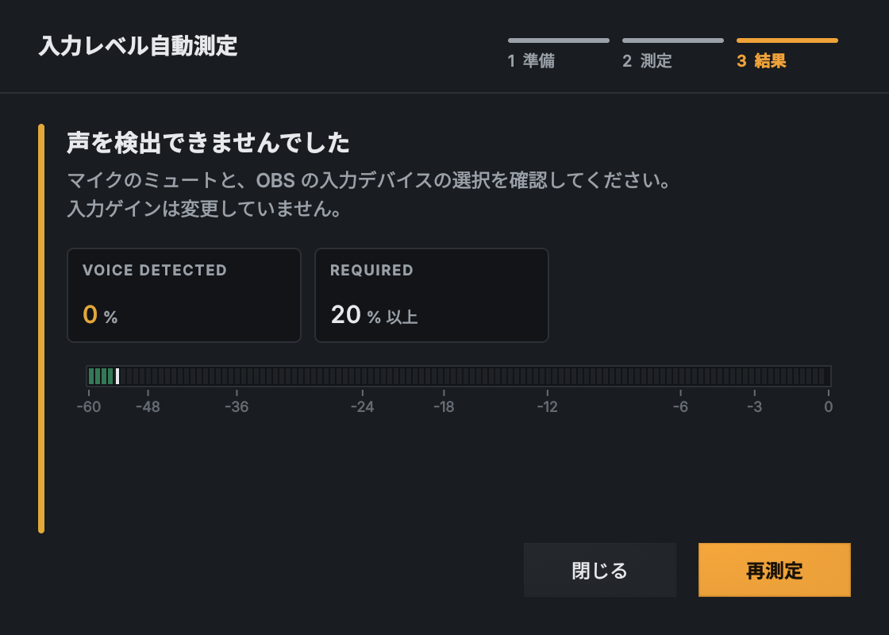 | 声を検出できず |
| 15 | 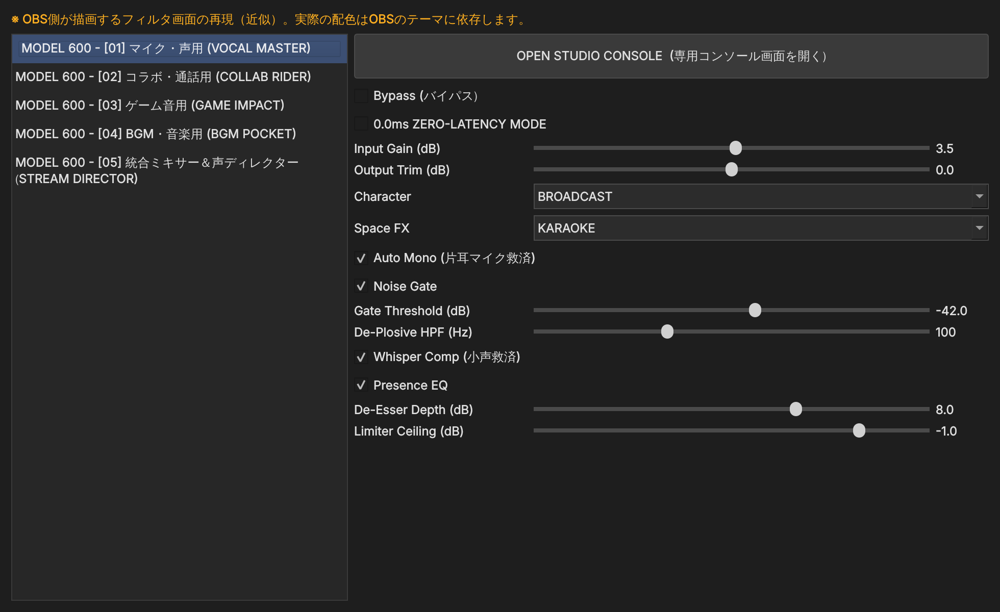 | OBS のフィルタ設定画面（**近似の再現**。実物は OBS が描画） |

## 注意

- 絵文字は使っていません。アイコンはピン留め・折り畳み・リセットの3種を線画で描いています。
- 15 番だけは本プラグインの描画ではなく、OBS 側の画面を Qt で再現した参考画像です。
