# GUI サンプル（全画面）

実装済みの Qt コード（`src/custom-ui-dialog.cpp`）をそのままオフスクリーン描画した画像です。
メーターの値は、各ユニットの DSP エンジンに実際に音声を流して得た値です（作り物の数値ではありません）。

再生成コマンド：

```bash
cmake -S . -B build -DMODEL600_BUILD_GUI_SAMPLES=ON
cmake --build build --target m600_render_gui_samples
QT_QPA_PLATFORM=offscreen QT_SCALE_FACTOR=2 ./build/m600_render_gui_samples docs/gui-samples
```

| # | 画面 | 内容 |
|---|---|---|
| 01 | 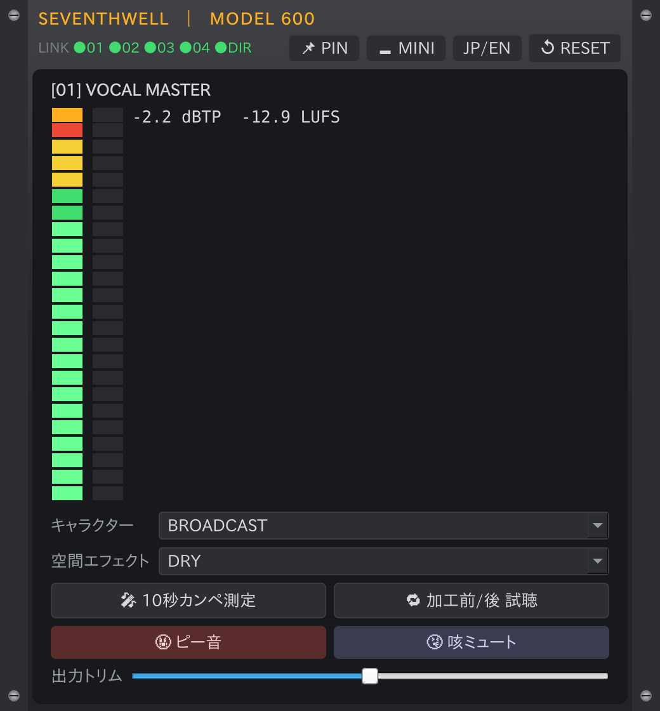 | [01] VOCAL MASTER のスタジオコンソール（日本語） |
| 02 | 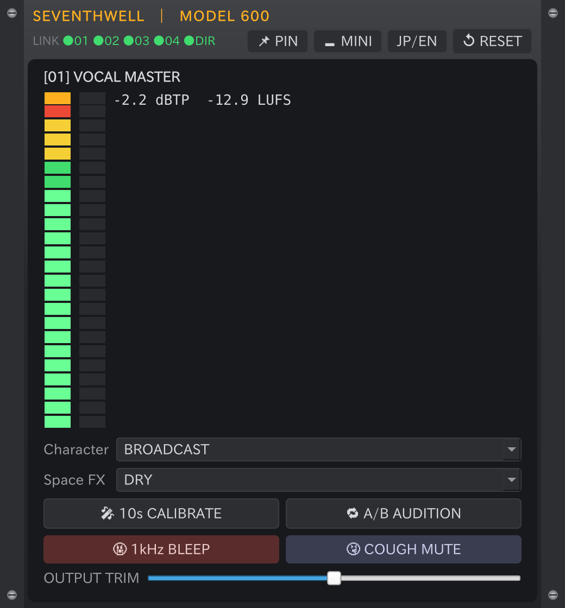 | 同・英語表示（JP/EN 切替後） |
| 03 | 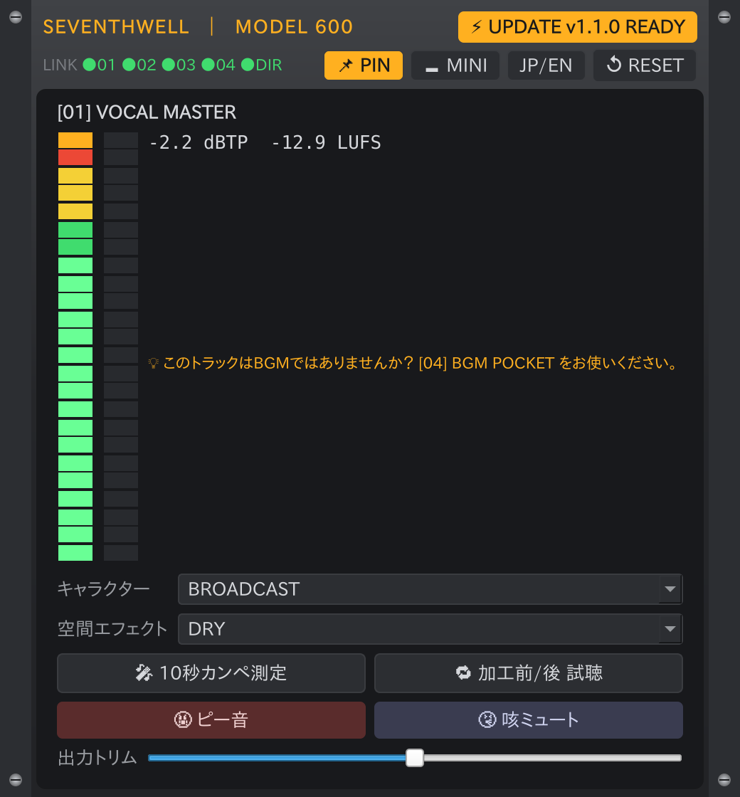 | BGM挿し間違いヒント表示、アップデートランプ点灯、PIN（最前面固定）ON |
| 04 | 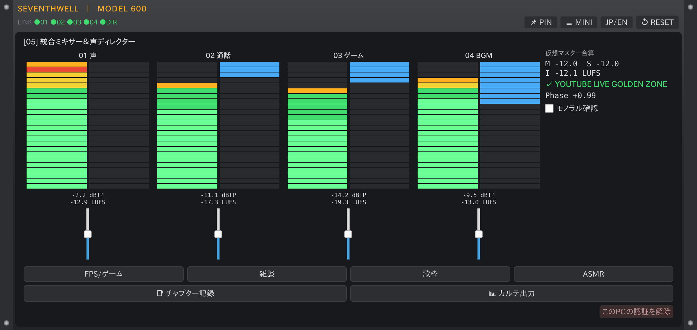 | [05] 統合ミキサー：4ch ストリップ、仮想マスター合算、YouTube 黄金帯域表示、シーンマクロ |
| 05 |  | 同・英語表示 |
| 06 | 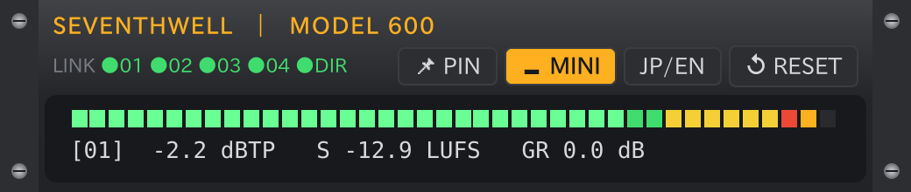 | MINI 表示（[01]、高さ約110px のメーターバー） |
| 07 | 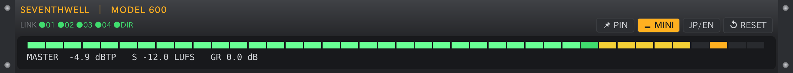 | MINI 表示（[05]、マスター） |
| 08 | 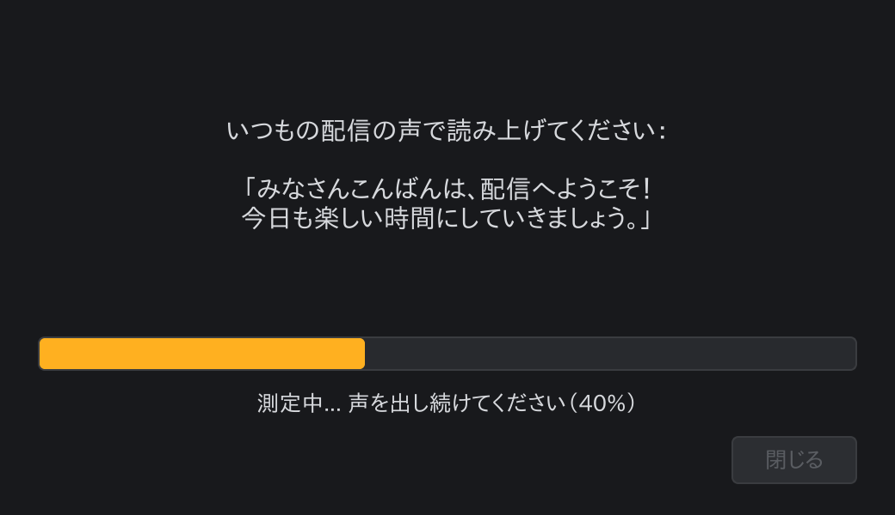 | 10秒カンペ測定：測定中 |
| 09 | 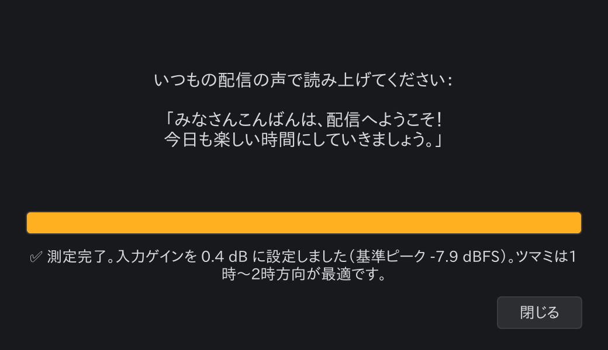 | 測定完了：入力ゲイン適用とツマミ位置の案内 |
| 10 | 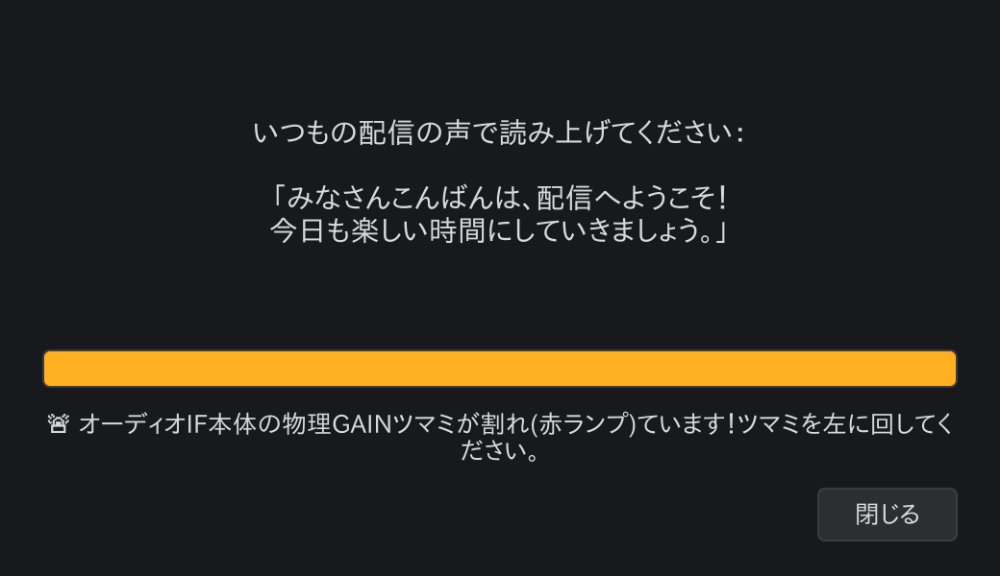 | 入力クリップ（オーディオIF の GAIN 過大）警告 |
| 11 | 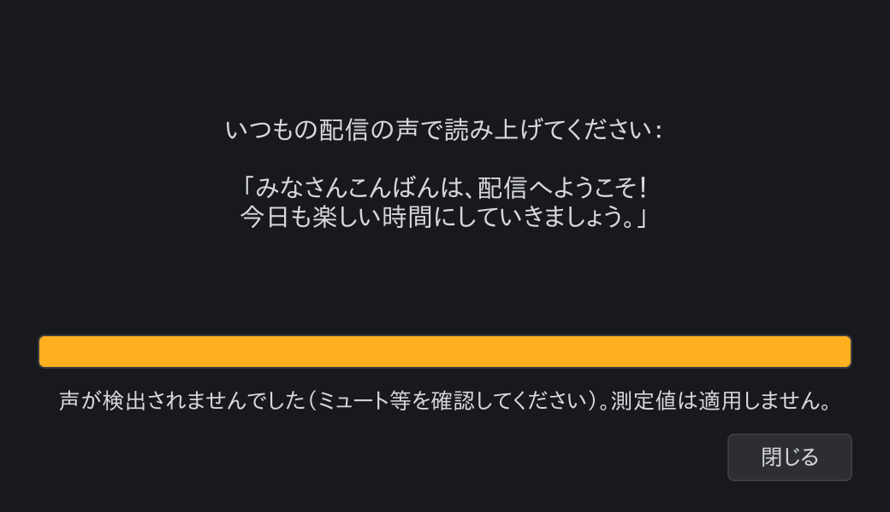 | 声が検出されなかった場合の警告 |
| 12 | 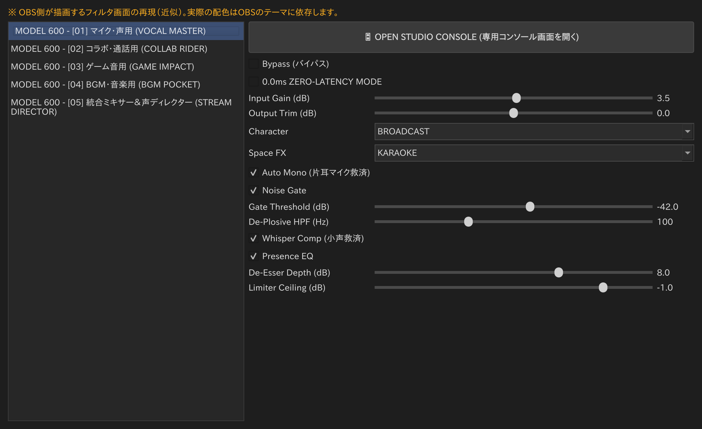 | OBS のフィルタ設定画面（**近似の再現**。実物は OBS が描画し、配色は OBS のテーマ次第） |

## 注意

- 絵文字（🎤 🤬 など）は、この描画環境ではモノクロの代替グリフで表示されています。Windows / macOS の実機ではカラー絵文字で表示されます。
- 12 番だけは本プラグインの描画ではなく、OBS 側の画面を Qt で再現した参考画像です。
